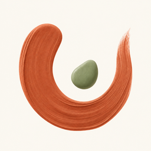
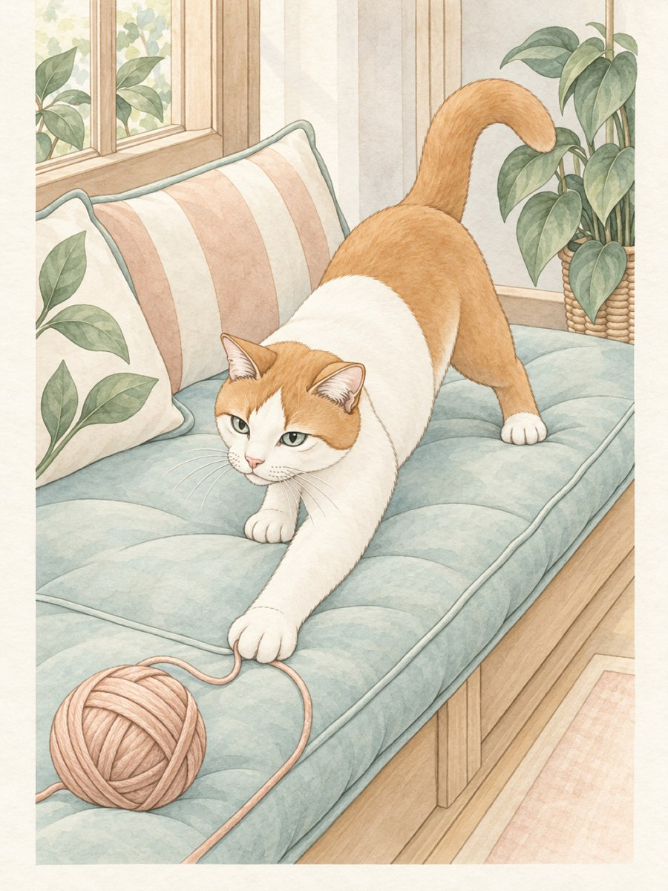
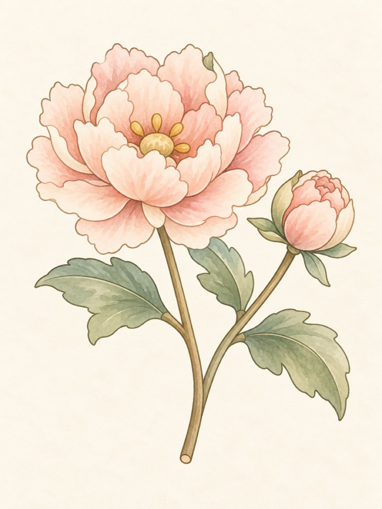
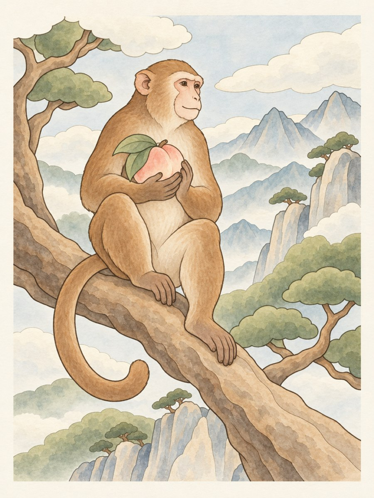

<h1 align="center">今日漫 · ColorBreathe</h1>

给今天，一点颜色。 Color slowly. Keep your day.

<a href="https://apps.apple.com/app/id6817821037">Download on the App Store</a> · <a href="https://sanctaz.github.io/colorbreathe-support/">中文介绍</a> · <a href="https://sanctaz.github.io/colorbreathe-support/en/">English</a>

  

一笔一画，慢慢涂。把作品、照片和几句话，留在只属于自己的日记里。

A quiet place to color and keep your day, made for iPhone and iPad.

### 让每一页，都有自己的颜色

- **14 本画册，168 幅画稿**：从花叶、猫咪到四时风物，每幅附有配色参考。
- **自然笔触，慢慢创作**：铅笔、水彩、蜡笔、岩彩，配合填色、图层、色盘与撤销重做；兼容的 iPad 支持 Apple Pencil。
- **作品也是日记**：把未完成的画、照片、文字与可选心情放在一起，日记可以单独上锁。
- **一小片安静**：无需注册、没有广告；作品与日记保存在设备上，支持离线涂色、记录与导出，也能手动备份带走。

免费从 12 幅入门画稿和每日轮换画稿开始，全部画笔、日记、备份与标准 PNG 导出均包含在内。可选「完整创作权限」解锁完整画库、辅助上色、空白画布、照片与线稿导入、高清和透明 PNG 导出。价格与可用方案以 Apple 购买页为准。

### A little color. A little you.

Explore 168 drawings across 14 collections, with a color reference for every page. Paint with natural brushes, then keep your artwork, photos and thoughts together in a private diary. No account, no ads, and your entries stay on your device.

Start free with 12 drawings, a daily featured page, every brush, the diary, backups and standard PNG exports. Optional Full Access adds the complete library and more creative tools. Apple shows available plans and local prices before purchase.

### 版本与帮助 · Versions & support

This website describes version **2.3**. Until the App Store update to 2.3 arrives, some new features may not be available yet. Availability varies by region and follows the App Store.

- **Help:** [中文](https://sanctaz.github.io/colorbreathe-support/support.html) · [English](https://sanctaz.github.io/colorbreathe-support/en/support.html)
- **Privacy:** [中文](https://sanctaz.github.io/colorbreathe-support/privacy.html) · [English](https://sanctaz.github.io/colorbreathe-support/en/privacy.html)
- **Terms:** [中文](https://sanctaz.github.io/colorbreathe-support/terms.html) · [English](https://sanctaz.github.io/colorbreathe-support/en/terms.html)
- **Contact:** [306116317@qq.com](mailto:306116317@qq.com)

This repository hosts the public product and support website. It does not contain the iOS app source. Artwork shown here is color-reference material from the app; some artwork is AI-assisted and reviewed, cleaned up and color-prepared by hand. Website artwork and screenshots are for product illustration, not a license for redistribution.
