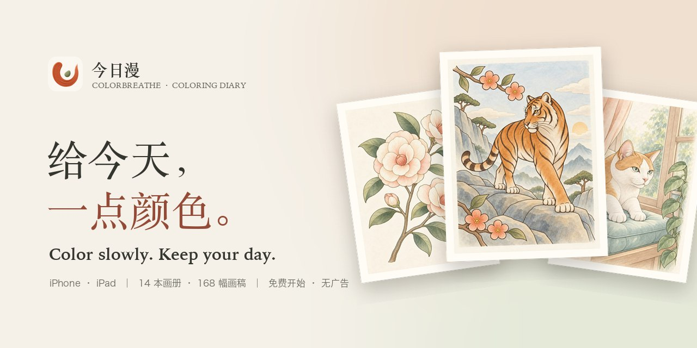
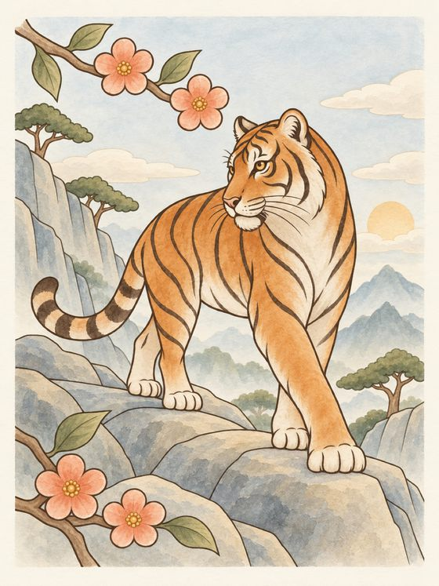
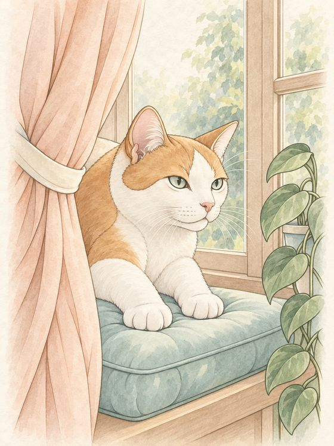
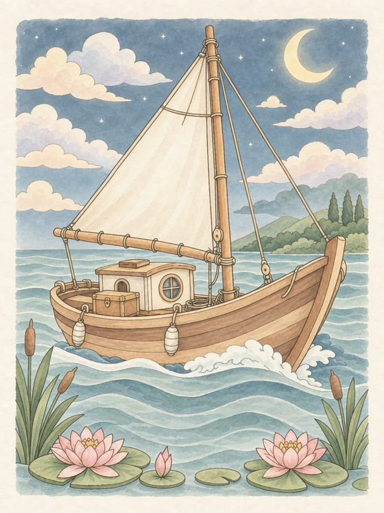
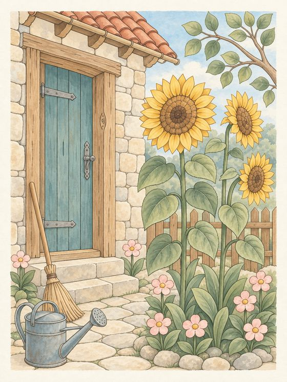
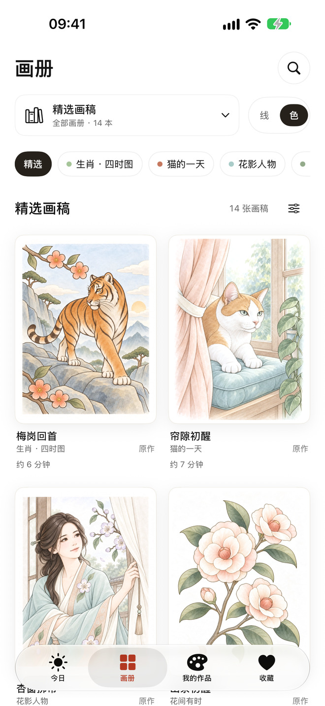
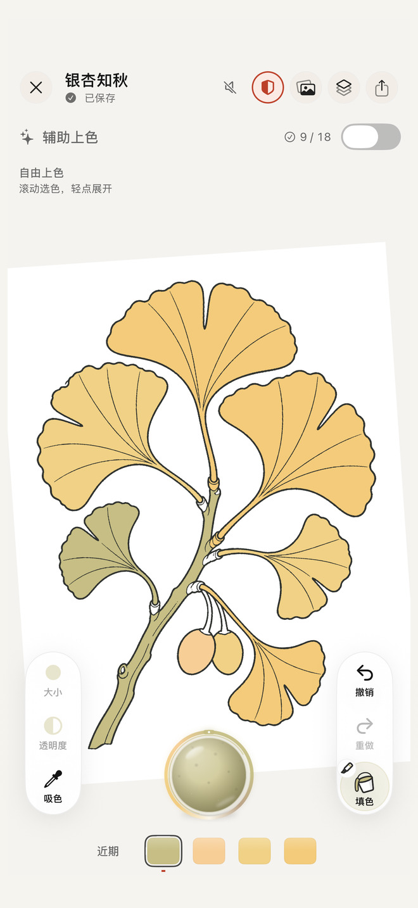
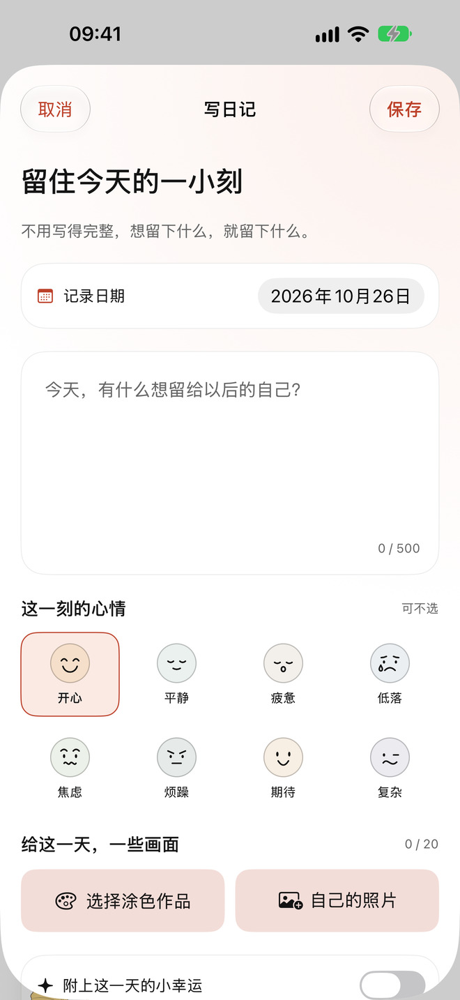

  

  <a href="https://apps.apple.com/app/id6817821037"><b>在 App Store 免费下载 · Download on the App Store</b></a>
   
  <a href="https://sanctaz.github.io/colorbreathe-support/">中文介绍</a> · <a href="https://sanctaz.github.io/colorbreathe-support/en/">English</a> · <a href="https://sanctaz.github.io/colorbreathe-support/support.html">帮助</a> · <a href="https://sanctaz.github.io/colorbreathe-support/en/support.html">Help</a>

iPhone · iPad　|　14 本画册 · 168 幅画稿 · 8 种画笔　|　免费开始 · 无广告 · 无需注册 · 离线可用

---

## 一页画，一点心情

从一幅喜欢的画开始，慢慢涂。把今天的心情、作品和几句话，收进只属于你的日记。

  
  
  
  

<b>14 本画册，168 次小小出走。</b>花间有时 · 枝上清音 · 林间伙伴 · 居家小憩 · 海天漫游 · 四时雅趣 · 花窗纹样 · 幻想微境 · 田园街巷 · 食光手作 · 童话漫游 · 生肖 · 四时图 · 猫的一天 · 花影人物。每幅画都配好了参考配色，借几种颜色就能开始，也能涂成自己的模样。

## 三步，开始今天的一页

<table>
  <tr>
    <td align="center" width="33%"> <b>挑一页</b> 每天一页轮换精选，也可以在 14 本画册里慢慢挑。</td>
    <td align="center" width="33%"> <b>慢慢涂</b> 轻点填色，或一笔笔画出自己的笔触，停下来会自动保存。</td>
    <td align="center" width="33%"> <b>记下今天</b> 写几句话、选一个心情、放一张照片，画到一半也值得记下。</td>
  </tr>
</table>

## 八种笔触，各有脾气

| 画笔 | 手感 | 画笔 | 手感 |
| --- | --- | --- | --- |
| 铅笔 | 叠两遍就有深浅 | 水彩 | 柔边晕染，叠色更浓 |
| 马克笔 | 一笔均匀，叠一遍更浓 | 蜡笔 | 用力一点更厚 |
| 丙烯 | 盖得住下面的颜色 | 喷枪 | 离得远一点更淡 |
| 柔影 | 深色轻叠阴影，浅色柔和提亮 | 岩彩 | 轻轻铺色，叠出细腻的矿物颗粒 |

所有画笔免费使用。图层、色盘、撤销重做都在手边；兼容的 iPad 支持 Apple Pencil。想偷个懒，就打开「辅助上色」，点一下区域，按参考配色填好。

**画累了，就玩一局「彩珠弹画」**：把自己的画变成一盘彩珠，借墙反弹、击中金环。在自己的作品上玩完一局（清空盘面或玩到时间结束），免费用户也能永久解锁这幅画的辅助上色。彩珠弹画在中国大陆以外的地区提供。

## 只属于你的一小片安静

- **不用注册，没有广告**：打开就能开始，没有广告，也没有行为追踪。
- **作品与日记，只在本机**：涂色、日记与导出都能离线完成；日记可以单独上锁。
- **留得住，也带得走**：每一笔自动保存，也能导出完整备份，换新设备时导入。

| 免费开始 | 完整创作权限（可选） |
| --- | --- |
| 12 幅入门画稿、每天轮换的一页、全部画笔、私人日记与备份、标准 2048 像素 PNG 导出 | 完整画库、辅助上色、空白画布、照片与线稿导入、4096 像素与透明 PNG 导出，回放与分享卡片可不带 App 标识 |

可选订阅或一次买断永久使用；实际方案与当地价格以 Apple 购买页为准。

---

## Color slowly. Keep your day.

A quiet place to color and keep your day on iPhone and iPad.

- **168 drawings in 14 collections**, from a single flower or a sleepy cat to seasonal scenes and tiny fantasy worlds — every page comes with reference colors.
- **Eight natural brushes**: pencil, watercolor, marker, crayon, acrylic, spray, shade and mineral, plus layers, palettes, undo and redo. Compatible iPads support Apple Pencil.
- **A private diary**: keep a few words, a mood, a photo or a half-finished page together. Your diary can be locked and stays on your device.
- **Marble Art**: turn your own drawing into a board of marbles; finish a round to permanently unlock assisted coloring for that drawing. Available outside mainland China.
- **Quiet by design**: no sign-up, no ads, no tracking, and it works offline.

Start free with 12 starter drawings, a daily featured page, every brush, the diary, backups and standard PNG exports. Optional Full Access adds the complete library, assisted coloring, blank canvases, imports and HD/transparent exports. Apple shows the available plans and local prices before purchase.

## 帮助与版本 · Help & versions

This website describes version **2.3**. Until the App Store update to 2.3 arrives, some new features may not be available yet. Availability varies by region and follows the App Store.

- **Help:** [中文](https://sanctaz.github.io/colorbreathe-support/support.html) · [English](https://sanctaz.github.io/colorbreathe-support/en/support.html)
- **Privacy:** [中文](https://sanctaz.github.io/colorbreathe-support/privacy.html) · [English](https://sanctaz.github.io/colorbreathe-support/en/privacy.html)
- **Terms:** [中文](https://sanctaz.github.io/colorbreathe-support/terms.html) · [English](https://sanctaz.github.io/colorbreathe-support/en/terms.html)
- **Contact:** [306116317@qq.com](mailto:306116317@qq.com)

This repository hosts the public product and support website. It does not contain the iOS app source. Artwork shown here is color-reference material from the app; some artwork is AI-assisted and reviewed, cleaned up and color-prepared by hand. Website artwork and screenshots are for product illustration, not a license for redistribution.
